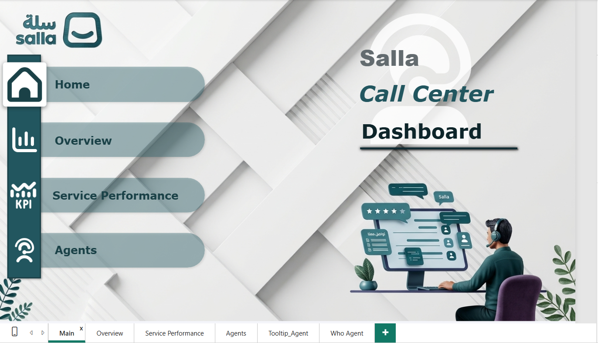
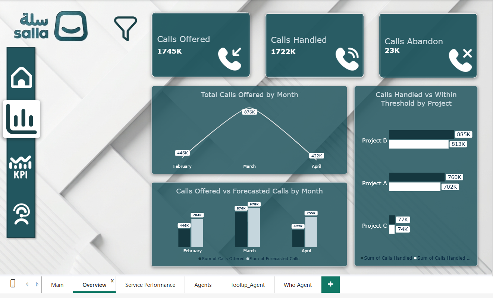
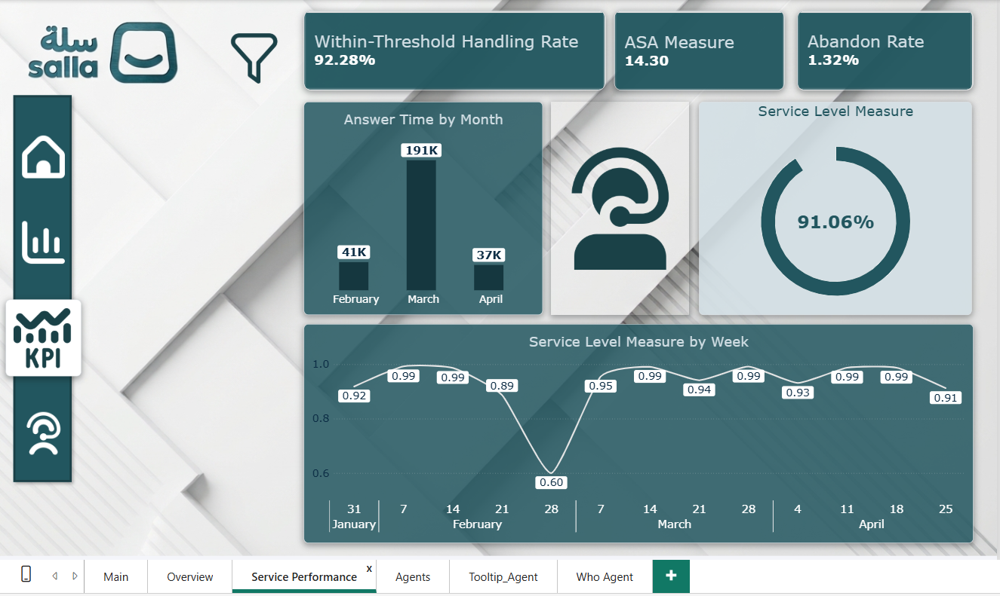
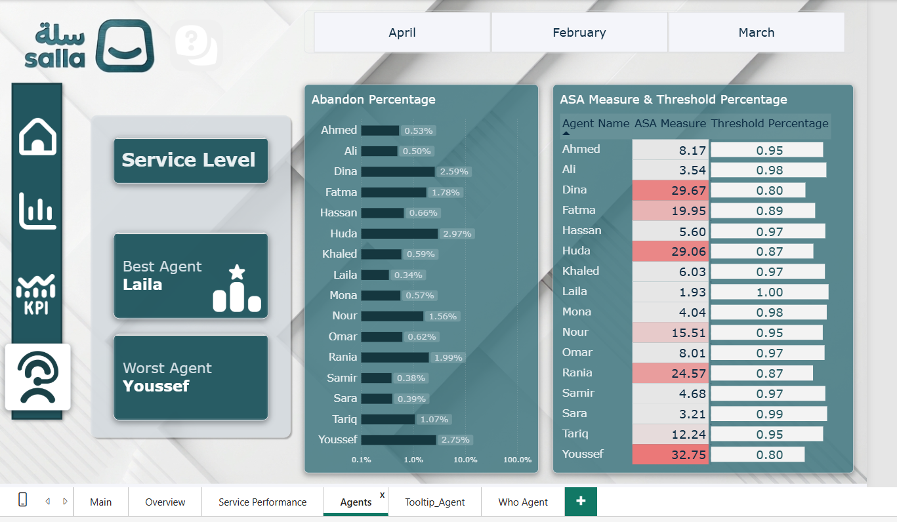
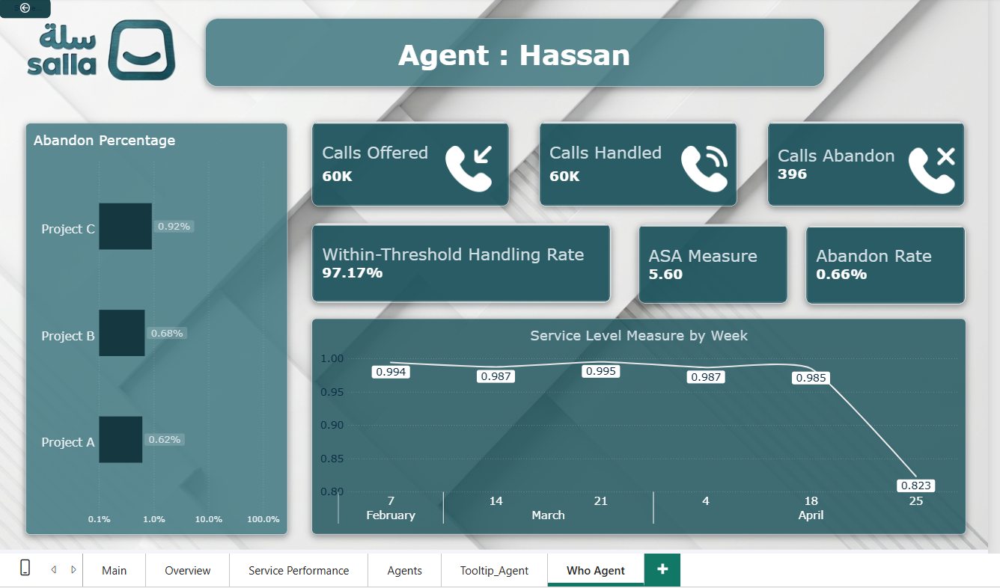
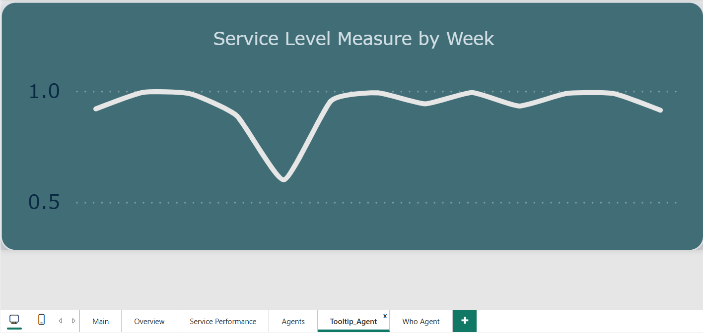

# Salla – Call Center Performance Analysis

## Project Overview

This project focuses on analyzing Call Center performance using Microsoft Power BI.

The main objective is to evaluate call center operations, monitor service performance, compare actual call volumes against forecasts, and analyze individual agent performance across multiple projects and months.

The analysis is based on three monthly data files covering February, March, and April, with daily reports for three different projects.

Beyond building an interactive report, this project was also an opportunity to explore a completely new business domain, understand its operational metrics, and translate its data into meaningful performance insights.

---

## Dataset Description

The dataset consists of three monthly files, each containing daily performance records for:

- Project A
- Project B
- Project C

### Main Data Fields

| Column | Description |
|---|---|
| Project | Project or campaign name |
| Date | Daily reporting date |
| Month | Reporting month |
| Forecasted Calls | Expected number of calls |
| Calls Offered | Actual number of incoming calls |
| Calls Handled | Number of calls answered by agents |
| Calls Handled Within Threshold | Number of calls answered within the target time |
| Calls Abandoned | Number of calls abandoned before being answered |
| ASA | Average Speed of Answer |
| Answer Time | Total answer time |
| Agent Name | Customer service agent's name |

---

## 1. Data Import and Preparation

### Combining Monthly Files Using Power Query

Instead of importing the three monthly files individually, I placed them in a single folder and connected Power BI to that folder using Power Query.

This approach was chosen to make the data model more scalable and easier to maintain.

**Why Folder Connection?**

- Combine multiple monthly files into one dataset.
- Reduce manual work when new monthly files become available.
- Allow newly added files to be included through the refresh process, provided they follow the same structure and format.

After reviewing the imported data, no additional data-cleaning operations were required.

---

## 2. Data Modeling and Date Table

To support time-based analysis, I created a separate Date Table using DAX and established a relationship between the Date Table and the main Salla data table through the Date column.

### Weekly Date Analysis

One of the challenges was displaying dates at the weekly level rather than showing every individual day.

To address this, I created the following calculated columns.

**Week Start**

Identifies the Monday of each week.

```dax
WeekStart =
'Date'[Date] - WEEKDAY('Date'[Date], 2) + 1
```

**First Week**

Formats the week-start date into a more readable label.

```dax
FirstWeek =
FORMAT('Date'[WeekStart], "d mmm")
```

**Month Start**

Creates a date value representing the first day of the month associated with the week-start date.

```dax
Month Start =
DATE(
    YEAR('Date'[WeekStart]),
    MONTH('Date'[WeekStart]),
    Day('Date'[WeekStart])
)
```

These columns were introduced to address date-axis display challenges and support a more readable weekly reporting experience.

---

## 3. DAX Measures and KPI Calculations

I created several DAX measures to calculate the main operational and service performance indicators.

### Within-Threshold Handling Rate

Measures the percentage of handled calls that were answered within the defined service threshold.

```dax
Within-Threshold Handling Rate =
DIVIDE(
    SUM('Sallah Project'[Calls Handled With in Thrshold]),
    SUM('Sallah Project'[Calls Handled])
)
```

### ASA Measure (Average Speed of Answer)

Calculates the overall average answer time using total answer time divided by total handled calls.

```dax
ASA Measure =
DIVIDE(
    SUM('Sallah Project'[Answer Time]),
    SUM('Sallah Project'[Calls Handled])
)
```

I used a DAX measure instead of taking a simple average of the existing ASA column because the overall metric should account for the number of calls handled on each day.

This introduced an important statistical concept: **Weighted Average vs. Simple Average**.

#### Understanding the Difference

Consider the following example:

| Day | Answer Time | Calls Handled | Daily ASA |
|---|---:|---:|---:|
| Saturday | 1,000 | 1,000 | 1 second |
| Sunday | 50,000 | 500 | 100 seconds |

**Simple Average:**

$$
(1+100)\div 2=50.5
$$

**Weighted Average:**

$$
\frac{51,000}{1,500}=34
$$

The results are significantly different:

- Simple Average = 50.5 seconds.
- Weighted Average = 34 seconds.

The Simple Average treats both days equally, even though Saturday had twice as many handled calls as Sunday.

The Weighted Average accounts for the different call volumes, giving each call its appropriate weight.

This makes the weighted calculation more representative of the overall average waiting time experienced across all handled calls.

### Abandon Rate

Measures the percentage of offered calls that were abandoned.

```dax
Abandon Rate =
DIVIDE(
    SUM('Sallah Project'[Calls Abandon]),
    SUM('Sallah Project'[Calls Offered])
)
```

### Service Level Measure

Measures the percentage of offered calls that were answered within the defined threshold.

```dax
Service Level Measure =
DIVIDE(
    SUM('Sallah Project'[Calls Handled With in Thrshold]),
    SUM('Sallah Project'[Calls Offered])
)
```

### Service Level Gap

Created an additional measure to represent the remaining percentage in the Service Level doughnut chart.

```dax
Service Level Gap =
1 - [Service Level Measure]
```

This allows the doughnut chart to display the Service Level percentage alongside its remaining portion.

---

## 4. Report Design and Pages

The Power BI report consists of three main analytical pages and one dedicated employee drill-through page.

### Main Page

A landing page that provides navigation between the different report sections.

It acts as the starting point for users to access the Overview, Service Performance, and Agents pages.

### Overview

Provides a high-level view of call center operations.

**Key Performance Indicators:**
- Total Calls Offered.
- Total Calls Handled.
- Total Calls Abandoned.

**Main Analysis:**
- Monthly call volume trends.
- Forecasted Calls vs. Calls Offered.
- Comparison of call volumes across projects.

The page also includes filters for Month, Project, and Agent Name to allow users to explore the data from different perspectives.

### Service Performance

Focuses on evaluating service quality and response efficiency.

**Key Performance Indicators:**
- Within-Threshold Handling Rate: 92.28%.
- ASA Measure: 14.30.
- Abandon Rate: 1.32%.

**Main Analysis:**
- Answer Time trends across months.
- Overall Service Level: 91.06%.
- Weekly Service Level trends from February to April.

This page helps evaluate how effectively the call center handles incoming calls and meets its service targets.

### Agents

Focuses on evaluating individual agent performance and comparing employees.

**Main Analysis:**
- Agent Abandon Percentage.
- ASA Measure by Agent.
- Within-Threshold Handling Rate by Agent.
- Identification of the best and worst-performing agents.

The report highlights:
- Best Agent: Laila.
- Worst Agent: Youssef.

These rankings are based on the overall dataset rather than being filtered by the selected agent name. They can change when the reporting month changes.

Conditional formatting was also used to highlight performance differences and draw attention to agents who exceeded the defined acceptable thresholds.

---

## 5. Advanced Power BI Features

In addition to the main report visuals, I implemented several interactive features to improve the user experience.

### Drill-Through – Who Agent

Created a dedicated drill-through page called **Who Agent**.

Users can select an agent from the Agents page and navigate to a detailed report specifically filtered for that employee.

The page includes:
- Calls Offered.
- Calls Handled.
- Calls Abandoned.
- Within-Threshold Handling Rate.
- ASA Measure.
- Abandon Rate.
- Weekly Service Level trends.

This provides a more detailed view of individual agent performance without overcrowding the main Agents page.

### Dynamic Filter Panel

Used the Selection Pane and Bookmarks to create filters that can be shown or hidden.

This provides more space for the report visuals while keeping filtering options accessible.

### Report Page Tooltip

Created a dedicated Tooltip page for agent analysis.

When hovering over an agent in the relevant visual, users can see a weekly Service Level chart filtered to that specific agent.

This provides additional information without requiring navigation to another page.

### Conditional Formatting

Applied conditional formatting to the Agents page visuals to highlight performance differences at a glance.

Agents who exceeded the defined acceptable thresholds (such as a high Abandon Rate or a high ASA) are visually flagged, which makes it easier to identify the best and worst-performing agents without reading every value.

---

## 6. Dashboard Preview

The following screenshots showcase the different pages and interactive features of the Power BI report.

### Main Page

The landing page provides navigation between the different report sections.



### Overview

Provides a high-level overview of call center operations, including call volumes, monthly trends, and forecast comparisons.



### Service Performance

Highlights service quality indicators, response times, abandonment rates, and weekly Service Level trends.



### Agents Performance

Provides a comparative analysis of individual agent performance, including ASA, abandonment percentage, and within-threshold handling rates.



### Agent Drill-Through Details

A dedicated page that provides detailed performance insights for a selected agent.



### Interactive Tooltip

Displays additional weekly Service Level insights when hovering over an agent in the Agents page.



---

## 7. Project Demonstration

A video walkthrough is available to demonstrate the report navigation, interactive filters, drill-through functionality, and analytical visuals.

[Watch Project Demonstration]()

---

## 8. LinkedIn

[View the Project on LinkedIn](Salla.mp4)

---

## 9. Tools and Technologies

- **Microsoft Power BI:** Report development, data modeling, and visualization.
- **Power Query:** Folder-based data import and combining monthly files.
- **DAX:** Calculated columns and performance measures.
- **Power BI Bookmarks & Selection Pane:** Interactive filter panel.
- **Power BI Drill-Through & Tooltips:** Detailed and contextual analysis.
- **Power BI Conditional Formatting:** Highlighting agents who exceeded the acceptable performance thresholds.

---

## 10. Key Learning Outcomes

One of the most valuable aspects of this project was learning how to work with a completely new business domain.

Before starting this project, I had no previous experience with Call Center operations and did not have a clear understanding of how this industry works or how its performance is evaluated.

Throughout the project, I learned to:

- Explore and understand an unfamiliar business domain.
- Understand Call Center terminology and operational performance indicators.
- Connect business concepts with the available data.
- Understand the difference between Simple Average and Weighted Average, and why choosing the correct calculation matters.
- Build a Date Table and perform weekly and monthly analysis.
- Create meaningful DAX measures for operational KPIs.
- Design interactive multi-page reports.
- Implement advanced Power BI features such as Drill-Through, Tooltips, and Bookmarks.
- Present operational data in a way that supports performance monitoring and evaluation.

**Most importantly, this project helped me understand that data analysis is not only about using tools and creating visualizations. It also requires understanding the business behind the data and knowing how to interpret its metrics correctly.**
